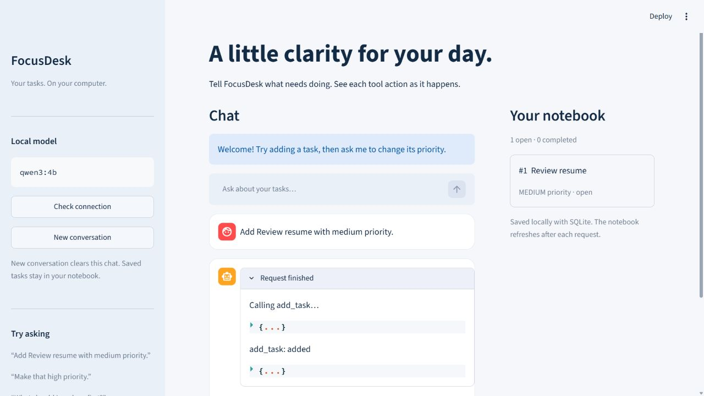
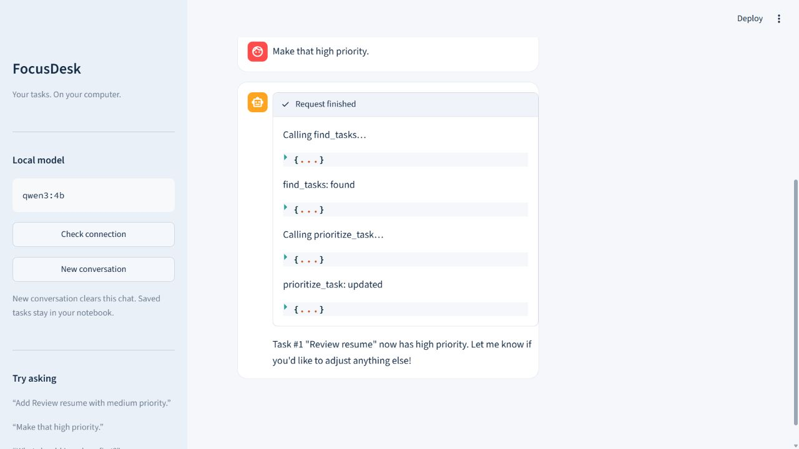
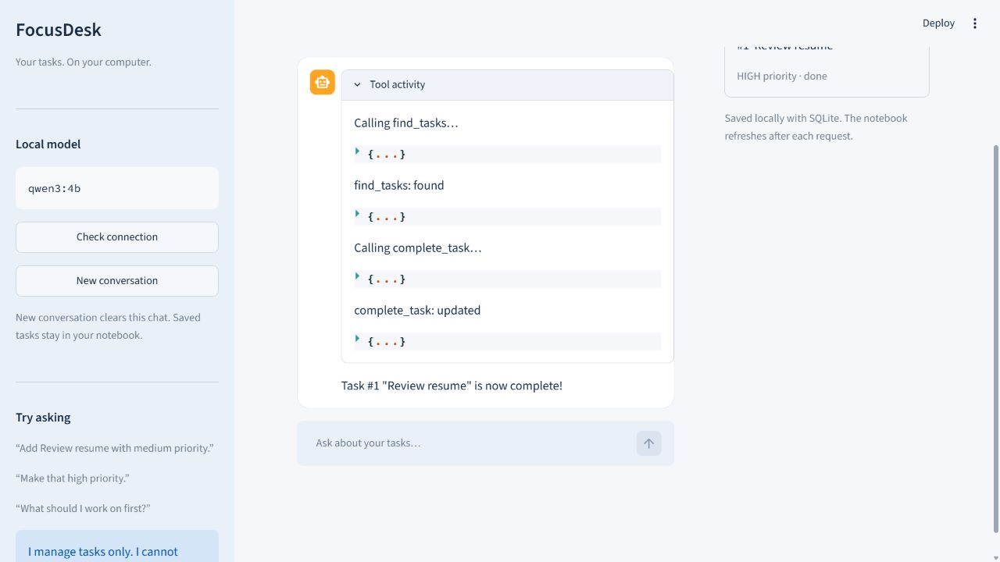

# FocusDesk — Local Agent App with UI

A conversational task notebook built with **Streamlit, Python, SQLite and Ollama**.
Add, list, find, complete and prioritize tasks in a browser. The model chooses tools;
Python validates every call and saves actual task changes locally.

[Watch / download the final UI demo](docs/focusdesk-ui-demo.mp4) — silent, about 59 seconds; real UI captures with waiting gaps and development retries omitted.

## What you get

- A simple chat interface with a live **tool activity** panel.
- Five tools with explicit JSON schemas and validated arguments.
- Session memory for follow-ups such as “make that high priority”.
- Persistent SQLite tasks and a notebook that refreshes after each request.
- Search-before-update safeguards, ambiguity questions and readable errors.
- A connection check and a new-conversation button that keeps saved tasks.

This app manages tasks only. It does not browse, send emails, schedule alarms or
push notifications. It is a single-user local app, not a hosted service.

## Provider and model: why Ollama + Qwen3?

**Ollama** serves **qwen3:4b** at `http://localhost:11434/api/chat`. It supports
structured tool calling, runs locally and needs no paid API key. The 4B model is a
practical local starting point, but CPU responses can take several minutes. Model
routing is probabilistic; application tests do not guarantee model reliability.

The client requests non-thinking mode in the API and each user prompt, temperature 0, a 4096-token context and a
512-token output cap. Visible activity shows tool names, inputs and results—not
private chain-of-thought. Truncated responses are rejected before any tool execution or display.
Each model request has a 300-second timeout and a turn
is limited to eight model rounds. Long sessions may exceed the context window;
use **New conversation** when needed.

## Setup from a fresh checkout

This repository contains the complete UI source, tests, configuration and example
screenshots. Clone it below, or download **Code → Download ZIP** and open a
terminal in the extracted folder containing `app.py`.

### Prerequisites

- Git (or download and extract the GitHub ZIP).
- **Python 3.14**, the version used for the clean-environment verification.
- [Ollama](https://ollama.com/download), installed and running locally.
- Enough memory and disk space for the model (the model download is about 2.5 GB;
  inference needs additional memory). A GPU helps, but is not required.
- Internet for the initial packages and model download. Chat then runs locally.

### Windows PowerShell

```powershell
git clone https://github.com/mubasheer26/focusdesk-streamlit-agent.git
cd focusdesk-streamlit-agent
```

For a downloaded ZIP, enter its extracted folder instead. Once in the
UI source folder (the one containing `app.py`):

```powershell
python -m venv .venv
.\.venv\Scripts\python.exe -m pip install -r requirements.txt
ollama pull qwen3:4b
.\.venv\Scripts\python.exe -m streamlit run app.py
```

### macOS / Linux

```bash
git clone https://github.com/mubasheer26/focusdesk-streamlit-agent.git
cd focusdesk-streamlit-agent
```

Or enter the extracted ZIP folder, then:

```bash
python3 -m venv .venv
.venv/bin/python -m pip install -r requirements.txt
ollama pull qwen3:4b
.venv/bin/python -m streamlit run app.py
```

Open **http://127.0.0.1:8501** and click **Check connection**. If Ollama is not
running, open its desktop application or run `ollama serve` in another terminal.
After setup, only the final Streamlit command is needed to launch the UI.
Stop the app with Ctrl+C in its terminal.

On Windows, after first-time setup you can also double-click **start.cmd**.
It runs the same Streamlit command from the correct project folder.

`requirements.txt` pins the direct dependencies and uses `requirements-lock.txt`
as constraints, so transitive dependencies use the verified versions too. The lock
records the resolved packages from the Windows/Python 3.14 environment.
Other operating systems have setup instructions but have not been tested here.

## Optional configuration

Copy `.env.example` to `.env` beside `app.py`, then edit:

```dotenv
FOCUSDESK_MODEL=qwen3:4b
FOCUSDESK_DB=data/tasks.db
```

No API key is required; no API-key environment variable is used. The local
`.env`, databases, recordings and virtual environment are excluded from Git.
Only the placeholder `.env.example` is committed. Existing environment variables
take precedence over `.env`. Restart the app after changing configuration.

## How to use it

1. Check the connection, then type a request into the chat box.
2. The status panel updates before each model request and tool execution.
3. Expand **Tool activity** to inspect inputs and actual results.
4. Read the assistant reply and confirm the task in **Your notebook**.
5. Start a new conversation to clear chat context while retaining tasks.

The database is shared by browser tabs; each tab has its own conversation.
Refreshing the browser may reset chat memory. Tasks remain on disk. Do not expose
the local server publicly: there is no login system. The included configuration
binds the UI to `127.0.0.1` and disables Streamlit usage telemetry.

## Example interactions and screenshots

Screenshots below are captured from the running UI. See `UI_VERIFICATION.md` for
which workflows completed in live-model checks and which are automated tests.

### 1. Add a task

> Add Review resume with medium priority.

The agent calls `add_task`; the notebook displays the saved task and its ID.



### 2. Follow up using conversation memory

> Make that high priority.

The recorded live workflow used `find_tasks`, inspected the match, then called
`prioritize_task`.
Only a unique match with fresh lookup evidence can be updated.



### 3. Complete a specific task

> Complete task #1.

The agent must find the task first, then request `complete_task` with the same
query. The notebook shows the resulting status.



## Tools and execution flow

| Tool | Parameters | Purpose |
| --- | --- | --- |
| `add_task` | `title`, optional `priority` | Add a task; avoid duplicate open titles |
| `list_tasks` | optional `status` | List open, done or all tasks by priority |
| `find_tasks` | `query` | Find title keywords or an explicit `#ID` |
| `complete_task` | `query` | Complete one task after a unique lookup |
| `prioritize_task` | `query`, `priority` | Set high, medium or low after lookup |

`User → model → tool-start event → argument validation → SQLite → tool-result
event → model → next tool or final answer`.

The message list retains system, user, assistant and tool messages for the whole
session. A fresh lookup map is created for each turn. Tool calls and results also
print in the terminal; these execution traces can contain task titles.

## Errors, ambiguity and limitations

- Unknown tools, missing fields, wrong types or extra fields return structured
  errors instead of executing arbitrary code.
- Several matching tasks trigger an ID question; no task is silently selected.
- Empty matches return an honest no-results response.
- Database failures preserve existing files; the app never silently resets data.
- Ollama unavailable, malformed responses and missing models show a UI error.
- If a tool succeeds but the next model request fails, the saved action remains.
  Check the notebook before retrying to avoid misunderstanding what changed.
- Batched model tool calls are rejected; dependent tools run sequentially.
- Outside-scope requests are constrained by the system prompt, but a small model
  may still route poorly. This is an educational portfolio app, not a guarantee
  of perfect natural-language interpretation.

## Tests

```powershell
.\.venv\Scripts\python.exe -m unittest discover -s tests -v
.\.venv\Scripts\python.exe -m pip check
```

On macOS/Linux use `.venv/bin/python`. The 28 deterministic tests cover the agent
and Streamlit UI, including saved actions after errors, session reset, memory,
ambiguity, validation and tool events before/after actual execution. UI tests use
scripted model replies; they are not a substitute for live inference.

Optional real-model evaluation (can be slow):

```powershell
.\.venv\Scripts\python.exe live_check.py --case 2
```

This creates isolated temporary databases. It never damages your task notebook.

## Troubleshooting

| Problem | What to do |
| --- | --- |
| Connection check fails | Open Ollama; confirm it is listening on localhost:11434 |
| Model missing | Run `ollama pull qwen3:4b` |
| Slow first response | Wait for model loading; close memory-heavy apps; CPU inference is slower |
| Model request fails | Check the notebook for saved changes, then retry or start a new chat |
| Port 8501 in use | Add `--server.port 8502` to the launch command |
| Database unavailable | Check the configured path/permissions; preserve the file and restore a valid backup |
| Temporary-folder permission error in tests | Set TEMP/TMP to a writable local directory before running tests |

## Project files

- `app.py`: Streamlit UI, configuration and live activity rendering.
- `task_agent.py`: five tools, validation, SQLite and model loop; also a CLI.
- `tests/`: deterministic agent and UI regression tests.
- `.env.example`, `.streamlit/config.toml`: safe local configuration defaults.
- `requirements.txt`, `requirements-lock.txt`: pinned dependencies.
- `docs/screenshots/`: real UI captures for the examples.
- `UI_VERIFICATION.md`: current UI and clean-checkout evidence.
- `VERIFICATION.md`: historical Week 3 model findings.

The separate Week 4 Tanglish explanation is a private local deliverable and is
not included in this repository update.

## Technical references

- [Streamlit chat elements](https://docs.streamlit.io/develop/api-reference/chat)
- [Ollama tool calling](https://docs.ollama.com/capabilities/tool-calling)
