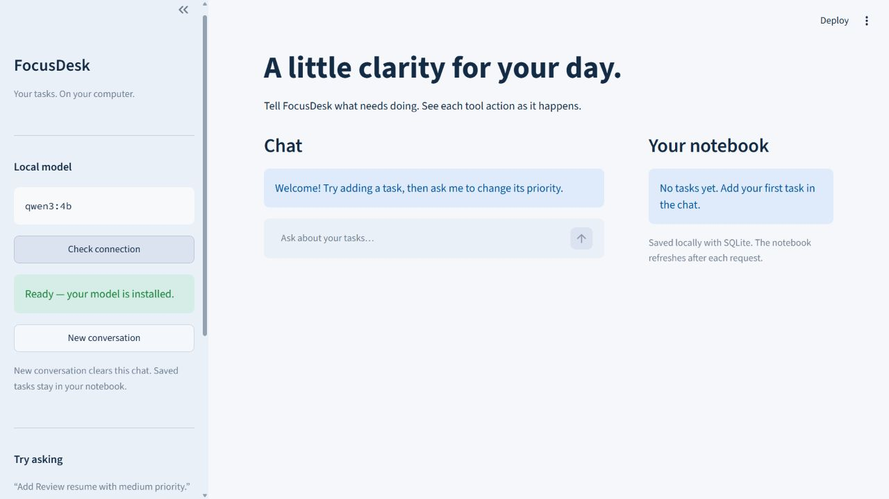

# UI verification

## Recheck — 12 October 2026

- Cloned the public repository at `27ebea0` into `focusdesk-clean-20261012`.
  That public revision is still CLI-only. Copied the local UI source, tests,
  configuration and documentation into this isolated checkout before testing.
  This verifies the supplied UI source, not the currently published revision.
- Created a fresh Python 3.14 virtual environment without system site packages.
- Installed the pinned direct dependencies, recorded the resolved dependency
  versions, and constrained `requirements.txt` to that updated lock file.
- `pip check`: no broken requirements. Streamlit imported as version 1.59.0.
- All **28 tests passed** in 2.238 seconds with normal Windows temp-folder access.
  An initial sandbox run failed because its temporary directory denied database
  access and cleanup; no application assertions were changed to obtain the pass.
- Started the fresh installation on `127.0.0.1:8503`. The empty notebook/chat loaded,
  and **Check connection** confirmed the installed real `qwen3:4b` model.
- Submitted `Add Review resume with medium priority.` in that browser. The real
  model called `add_task`; the notebook displayed task #1 as open/medium before
  the final reply. The assistant then confirmed the saved task. CPU inference
  took several minutes, so this is not an instant-response claim.
- [Today's activity capture](docs/screenshots/04-live-activity.png) records the
  completed tool action in the current narrow browser viewport.
- The three README interaction screenshots and edited video below remain the
  real captures from 7 October. They are not represented as new captures.

The source ZIP excludes virtual environments, databases, actual `.env` files,
private learning notes, and raw local recordings. Python and the installed Ollama
model are prerequisites, not bundled dependencies. macOS/Linux remain unverified.

## Earlier verification — 7 October 2026

## Clean-environment check

- Cloned the public repository into a separate folder and applied the Week 4 source update.
- Created a new `.venv` with Python 3.14 on Windows; no global site packages.
- Installed exactly with `python -m pip install -r requirements.txt`.
- `python -m pip check`: no broken requirements.
- Started `python -m streamlit run app.py --server.port 8502` from that checkout.
- Opened the UI in a browser: empty notebook and chat loaded successfully.
- Clicked **Check connection**: “Ready — your model is installed.”
- No `.env` or API key was needed. The already-installed Ollama service and
  qwen3:4b model were reused; OS/Python/Ollama installation itself was not repeated.
- The full installed package set is pinned in `requirements-lock.txt`.

The restricted test runner initially could not use its default temporary folder;
TEMP/TMP were pointed at a writable test directory. One cold UI test also exceeded
its original 20-second timeout while CPU inference was active. The UI harness now
allows 60 seconds and cleans up even if setup fails. After those environment/test
harness fixes, **all 28 tests passed** (22.771 seconds in the final fresh-env run).
No application assertions were removed or weakened.

## Automated coverage

24 agent tests plus 4 UI/event tests use temporary SQLite databases and scripted
model replies. They cover schema validation, persistent storage, duplicate tasks,
lookup-before-update, ambiguity, no results, unknown tools, argument errors,
malformed/truncated model responses, storage failure, network failure after a
successful write, memory, loop bounds, UI reset, and live event ordering.

These tests verify application behaviour, not the correctness of every model reply.

## Real browser + Ollama checks

The following requests were submitted through the running Streamlit UI, using
real qwen3:4b responses. No demo model or scripted replies were used for captures.

| Request | Observed tool execution and result |
| --- | --- |
| Add Review resume with medium priority. | `add_task` saved #1, open, medium; final reply confirmed it |
| Make that high priority. | `find_tasks` resolved the earlier task, then `prioritize_task` saved high; final reply confirmed it |
| Complete task #1. (after the response-handling fix, in a new chat) | `find_tasks` found #1, then `complete_task` saved done; final reply confirmed completion |
| New conversation | Chat cleared; #1 remained in the notebook as high/done |

The first completion attempt returned a truncated model response without a tool
call. The task stayed open. We added explicit rejection of output-limit responses
and unfinished thinking markup, and applied Qwen's `/no_think` switch to each user
prompt as well as the system prompt. A regression test covers rejection before
execution/display. The subsequent completion attempt succeeded.

Tool activity is expanded during processing. The notebook refreshes after each
tool result, so a saved update remains visible even while the model prepares its
final answer. CPU inference took minutes for some turns; latency remains a
practical limitation. The earlier Week 3 report is historical and predates these
successful UI priority/completion checks.

## Screenshots and demo

The README embeds three real UI screenshots. The [silent MP4 demo](docs/focusdesk-ui-demo.mp4)
is approximately 59 seconds, assembled from real browser screen captures sampled
at about one frame per second, encoded at 10 fps. Waiting gaps and development
retries are omitted; the on-video label states that it is edited. It demonstrates
task creation, a memory-based priority follow-up, lookup/completion, and chat reset
with persistent tasks. It is not an uninterrupted real-time performance benchmark.
The complete encoded video was decoded successfully as a validation check.

No personal tasks, private settings, raw local transcripts or the separate Week 4
Tanglish explanation are part of this update.

Reference: [Qwen non-thinking prompt switch](https://github.com/QwenLM/Qwen3/blob/main/docs/source/getting_started/quickstart.md).
